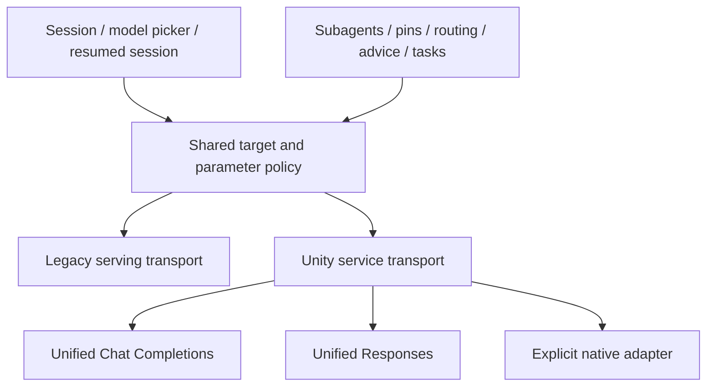

# Unity Gateway model services: analysis and implementation plan

Status: core unified model-service support implemented and qualified. Native
OpenAI Responses is also qualified; native Anthropic/Gemini adapters remain
optional follow-ups. See [qualification results](15-unity-gateway-qualification.md)
for the live matrix, validation, and upstream limitations.

Initial audit on 20 October 2026 (Australia/Sydney), against commit
`5c28a8add76a9867256f7997aa83aa50627a6907`. Sections 3–4 preserve the baseline
findings; sections 5–7 record the implementation design and acceptance criteria.

## Implementation status

The runtime now uses `deepagents-code==0.1.86` with `deepagents==0.7.28`, on
Python 3.12+. The official `langchain-openai` adapter and request-time Databricks
SDK unified authentication replace the Databricks bridge. The latest bridge
requires MCP 1 while the latest selected runtime requires MCP 2, so both cannot
coexist in the same environment.

The upgrade set is recorded in `pyproject.toml` and the portable
`requirements-dev.lock` (177 packages with platform markers):

| Library or SDK | Baseline installed | Upgraded |
| --- | --- | --- |
| Deep Agents Code | 0.1.7 | 0.1.86 |
| Deep Agents | 0.6.7 | 0.7.28 |
| Databricks SDK | 0.94.0 | 0.154.0 |
| LangChain | 1.3.2 | 1.4.6 |
| LangChain Core | 1.4.0 | 1.6.11 |
| LangChain OpenAI | 1.2.2 | 1.7.2 |
| OpenAI SDK | 2.40.0 | 3.31.0 |
| Databricks LangChain/OpenAI/AI Bridge | 0.19.0 / 0.15.0 / 0.19.0 | Removed |

The lock updates the TUI, MCP, LangGraph, provider SDKs, and development tools to
the latest compatible releases resolved on 20 October 2026. Pydantic 2.13.5,
filelock 3.29.7, and uuid-utils 0.17.1 remain below their standalone latest
releases because of upstream bounds. CI installs the lock and tests Python 3.12
and 3.14.

Implemented capabilities:

- Exact endpoint/service identity, shared constructor and registry policy,
  per-target settings, validated request tags, and explicit native OpenAI routing.
- Legacy `/serving-endpoints`, unified `/ai-gateway/mlflow/v1`, and native OpenAI
  `/ai-gateway/openai/v1`, preserving the exact model identifier. Services prefer
  Responses, with metadata and exact qualified compatibility selecting Chat.
- Independent SDK Unity/legacy discovery, bounded lookups, structured outcomes,
  scoped caches, private pins, and infer-only operation when metadata is denied.
- Service-aware model picker, verification, doctor tool-loop probes, and gateway
  inspection. Missing visible governance is reported as unknown.
- Sync/async streaming and tool replay, opaque Responses/Gemini Chat state
  preservation, usage normalization, and checkpoint dialect continuity.
  Incompatible opaque-history switches fail before inference.
- Shared launch, runtime, delegated-agent, headless, background, and workspace
  policy; request-time auth refresh; explicit model/resume precedence.
- Additive usage-ledger provenance, exact service price overrides, unknown-price
  completeness in reports and evals, and honest partial USD budget accounting.
- Central latest qualified role defaults and ownership-aware provider inventory
  migration that preserves existing user defaults, pins, and other providers.

Live labs qualification covered the latest GPT/Claude role choices, Gemini Chat,
legacy endpoints, native OpenAI Responses, and real headless/background runs.
Gemini unified Responses tool continuation currently fails in the gateway even
when raw server output is replayed untouched; exact qualified Gemini services
use unified Chat and retain its `thoughtSignature` state. This is an explicit
compatibility choice, with no error-triggered model/provider fallback.

Workspace enforcement, infer-only credentials, and custom routing/fallback are
covered by deterministic contracts where live test resources were unavailable.
Native Anthropic/Gemini APIs, embedding generation, service provisioning, and
gateway billing reconciliation are outside the core unified scope. Consult the
qualification report before treating a particular model option as supported.

## 1. Repository status and recommendation

At the initial audit, the checkout was synchronized with remote `main`. Local `HEAD`, cached
`origin/main`, and GitHub's live `refs/heads/main` all resolve to the commit above.
`git rev-list --left-right --count HEAD...origin/main` returned `0 0`. The working
tree was clean before this plan was added. No pull, merge, or reset was necessary.
The implementation described above is now a local change on that baseline.

Manta needs a model-service-aware integration, rather than a list of renamed
endpoints. Keep the public `databricks:<target>` syntax and existing integration
with Deep Agents. Add a shared target and protocol policy, enable Unity Gateway
transport for service names, discover services through Unity Catalog, and qualify
Responses tool conversations before advertising support for the newest models.

The initial audit found gateway transport in the installed Databricks clients,
alongside protocol correctness gaps. The selected implementation uses the
official OpenAI adapter instead. The implementation now shares construction across session and delegated
models, discovery and diagnostics, qualified transports, and usage accounting.

## 2. What changed in Databricks

### Addressing and inference APIs

A model service is a Unity Catalog object, addressed for inference by its exact
three-part name, such as `system.ai.claude-sonnet-4-5`. Its management resource is
`model-services/<catalog>.<schema>.<service>`. This is distinct from a legacy
serving endpoint, a registered model/version, and a model provider service.

For model services, the common inference base is
`https://<workspace>/ai-gateway/mlflow/v1`. Both `/chat/completions` and `/responses`
are available; Databricks recommends unified Responses. The shared surface lets
applications use multiple providers with one dialect. Exact support still depends
on the service. [Query model services](https://docs.databricks.com/aws/en/ai-gateway/query-model-services)

Native APIs expose provider-specific features:

| API | Workspace route | Applicable model service |
| --- | --- | --- |
| Unified Chat Completions | `/ai-gateway/mlflow/v1/chat/completions` | Services advertising the corresponding unified API |
| Unified Responses | `/ai-gateway/mlflow/v1/responses` | Services supporting unified Responses |
| Native OpenAI Responses | `/ai-gateway/openai/v1/responses` | GPT-backed services |
| Native Anthropic Messages | `/ai-gateway/anthropic/v1/messages` | Claude-backed services |
| Native Gemini | `/ai-gateway/gemini/v1beta/models/<FQN>:generateContent` | Gemini-backed services |

The native SDK base ends at `/anthropic` or `/gemini` respectively; the SDK adds
the protocol suffix. Databricks bearer authentication applies to those routes.
Sources: [OpenAI](https://docs.databricks.com/aws/en/machine-learning/model-serving/query-openai-responses),
[Anthropic](https://docs.databricks.com/aws/en/machine-learning/model-serving/query-anthropic-messages),
[Gemini](https://docs.databricks.com/aws/en/machine-learning/model-serving/query-gemini-api).

Service names are opaque. Current documented examples include
`system.ai.gpt-6-1-sol` and `system.ai.databricks-gemini-4-argon`; there is no
universal rule for adding or removing `databricks-`. Several recent GPT entries
explicitly require Responses. Supporting only Chat Completions would leave the
latest-model requirement incomplete.
[Supported models](https://docs.databricks.com/aws/en/machine-learning/foundation-model-apis/supported-models)

### Discovery, access, and rollout

List services with
`GET /api/2.1/unity-catalog/model-services?parent=schemas/system.ai`, following
`next_page_token`. The default page size is 100, with a maximum of 200. Other
schemas require separate requests. `BASIC` is the default view; use `FULL` for
detailed configuration. Results expose `supported_api_types` and resource names.
The API scope is `unity-catalog`. Visibility through metadata or management
privileges does not establish permission to execute.
[Model Service API](https://docs.databricks.com/api/ai-gateway/v1/model-service)

Inference requires `EXECUTE` on the service plus `USE CATALOG` and `USE SCHEMA`.
The service owner's privileges authorize access to its destinations. A caller
does not need direct privileges on every backend. Grant propagation can take
several minutes.
[Govern model services](https://docs.databricks.com/aws/en/ai-gateway/govern-model-services)

The workspace must support Unity Gateway and have Unity Catalog enabled; the
caller needs Workspace access or Consumer access entitlement. Individual model
availability and cross-geography routing requirements need separate diagnosis.
A gateway-supported region does not establish availability of every model.
Sources: [Query requirements](https://docs.databricks.com/aws/en/ai-gateway/query-model-services)
and [model availability](https://docs.databricks.com/aws/en/machine-learning/foundation-model-apis/supported-models).

OAuth and PAT authentication are supported. The workspace `/ai-gateway/` route
recommends the `ai-gateway` PAT scope. Discovery and other Manta tools have their
own scope needs. A gateway-scoped credential must be usable for inference even
when it cannot perform discovery or `current_user.me()`.

Unity enforcement disables legacy pay-per-token `databricks-*` endpoints; new
workspaces enforce Unity Gateway by default. Existing endpoint governance and
registered-model grants do not automatically migrate to services. This makes
the current built-in pins a compatibility problem for enforced workspaces.
[Migration guide](https://docs.databricks.com/aws/en/ai-gateway/migrate-to-unity-gateway)

Unity Gateway became generally available on 4 August 2026, and its management API
and developer tools on 16 September. The documented Python SDK floor for that
management API is `databricks-sdk>=0.136.0`. Some capabilities, including service
policies, remain separately gated beta features. Prefer current release notes
over older introductory pages that still label the entire feature beta.
[Unity Gateway release notes](https://docs.databricks.com/aws/en/release-notes/unity-gateway)

## 3. Baseline behavior before the migration

This section records the original audit at the commit above. Consult the
implementation status for behavior changed by the current patch.

| Area | Current behavior | Required change |
| --- | --- | --- |
| Reference parsing | `providers/__init__.py:42` accepts dots in `provider:model` | Preserve syntax; add target kind and exact identity |
| Model construction | `providers/__init__.py:88` passes only `model` to `MantaChatDatabricks` | Resolve surface, protocol, parameters, and auth consistently |
| Main model | `dcode.py:97` configures a class-path provider and preserves provider parameters | Apply the same policy as registry-built models |
| Subagents | `databricks_chat.py:209` patches Deep Agents resolution | Keep the seam and resolve service targets through it |
| Pins and routing | `middleware/routing.py:116`, `:186`, and `advice.py:359` construct replacement models | Use the shared policy; surface explicit-pin failures |
| Discovery | `auth.py:136` lists serving endpoints with task `llm/v1/chat` | Add independent, paginated UC service discovery |
| Launch inventory | `main.py:171` unions configuration with legacy discovery | Register services, including Responses-capable targets |
| Verification | `main.py:285` and `:604` compare pins against legacy inventory | Verify by target kind and report inconclusive discovery |
| Doctor probes | `main.py:1215` probes chat and recognizes Responses-only through exception text | Use metadata and a protocol-aware agent-loop probe |
| Gateway inspection | `providers/gateway.py:1`, `:120` assumes governance on serving endpoints | Inspect model services separately and retain legacy visibility |
| Model picker/workspaces | `_boot.py:137`, `:198`, `:491`, `:540` uses registered names and profile switches | Refresh capability inventory and isolate workspace caches |
| Built-ins | `config.py`, `agents/defaults.py`, `agents/authoring.py`, `middleware/routing.py` hardcode legacy pins | Centralize role choices and migrate managed defaults deliberately |
| Accounting | `agents/usage.py:66`, `:119`; `middleware/economy.py:350` price the requested model by substring | Preserve target/backend identity and pricing provenance |

At baseline, passing `databricks:system.ai.<name>` proved only that strings
survived the parser and configuration. No Manta code enabled `use_ai_gateway`,
so the installed client selected the legacy serving route.

The main class-path model could receive existing Deep Agents provider parameters;
the registry factory ignored them. Enabling Unity through one global provider
parameter would therefore leave delegated agents inconsistent and misroute
legacy endpoints in a mixed inventory. The replacement adapter resolves the
route from each name, while sharing provider parameters remains outstanding.

Discovery errors often become an empty list. Consequently, doctor can
skip validation entirely when discovery fails, or incorrectly report a service
pin as missing when legacy discovery succeeds. Metadata visibility, execution
access, and transport compatibility must be separate findings.

The normal resolver's best-effort `None` result can leave the session model in
place when a replacement fails. For an explicit service pin, that can change the
selected model and its governance boundary without a useful error. Retain soft
failure for optional discovery; use a clear resolution error for explicit pins.

## 4. Baseline dependency and offline compatibility findings

Before migration, the installed environment contained:

| Package | Installed | Manifest requirement |
| --- | --- | --- |
| `databricks-langchain` | 0.19.0 | `>=0.4` |
| `databricks-openai` | 0.15.0 | Transitive |
| `databricks-sdk` | 0.94.0 | `>=0.40` |
| `langchain-core` | 1.4.0 | Transitive |
| `deepagents` | 0.6.7 | Exact pin |
| `deepagents-code` | 0.1.7 | Exact pin |

That installed `ChatDatabricks` exposed `use_ai_gateway`,
`use_ai_gateway_native_api`, and `use_responses_api`, all false by default.
Its Databricks OpenAI client resolves gateway URLs directly; the implementation
does not discover availability despite the flag's current docstring.

Baseline SDK 0.94.0 had neither `WorkspaceClient.model_services` nor
`WorkspaceClient.ai_gateway`. Do not assume a modern management accessor is
available just because inference already works. Raise and validate the SDK floor
against the documented management API; inspect the actual accessor in the
selected version before coding against it.

These baseline checks used an `.invalid` fixture host and synthetic
credentials/messages; no model request was sent. The Databricks bridge is
removed by the current implementation, so these findings are motivation and
regression cases rather than claims about the replacement adapter:

| Offline check | Observed result | Consequence |
| --- | --- | --- |
| Default client URL | `/serving-endpoints` | Existing service strings select the wrong surface |
| `use_ai_gateway=True` | `/ai-gateway/mlflow/v1` | Preserve the documented unified gateway route |
| Native gateway flag | `/ai-gateway/openai/v1` | This flag supplies OpenAI native routing, not every vendor protocol |
| One Responses function call represented in both content and `tool_calls` | Two function-call input items on replay | Fix duplicate serialization before multi-turn tool use |
| Parsed reasoning block with opaque state through Manta normalization | Content becomes `''` | Restrict the legacy display fix; preserve protocol state |
| Forced Responses tool selection | Chat-style nested `function` shape retained | Convert tool choice as well as tool schemas |
| Responses model configured with `max_tokens=32` | Neither `max_tokens` nor `max_output_tokens` emitted | Map and validate output limits by protocol |
| `timeout=20` or `max_retries=1` | Client construction raises `TypeError` | Qualify the client pair and implement settings through a supported seam |

Relevant baseline upstream code was in
`databricks_langchain/chat_models.py:295`, `:345`, `:463`, `:539`, `:1474`,
and `databricks_openai/utils/clients.py:111`, `:382`, `:543`.
Upstream reports corroborate the
[client kwargs mismatch](https://github.com/databricks/databricks-ai-bridge/issues/423)
and separately identify
[missing Responses usage detail handling](https://github.com/databricks/databricks-ai-bridge/issues/461).
The latter needs its own fixture; the issue's status alone is not proof of the
behavior of a future dependency set.

The Responses history converter also mutates content dictionaries when preparing
requests. Add an immutability check so retries and checkpointed conversations do
not acquire transport-dependent changes.

Do not solve these problems by globally setting `use_responses_api=True`.
Chat Completions is a useful first delivery for compatible services, but robust
Responses support is a required milestone for full latest-model support.

## 5. Full-support implementation design

The initial design considered retaining the Databricks bridge transport. That
dependency choice is superseded by the direct `ChatOpenAI` plus SDK adapter
described above. The target policy, discovery, diagnostics, accounting, and
qualification requirements remain applicable.

### One target identity and one construction policy

Add a small dependency-light module such as `providers/targets.py`, containing a
typed target with:

- Public reference and exact inference identifier.
- Kind: legacy serving endpoint or Unity Catalog model service.
- Management resource, where applicable.
- API dialect, selected parameters, and capability evidence.
- Workspace/profile identity used to scope discovery, never credentials.

Keep `databricks:<target>` as the stable external format. Accept a bare service
FQN in Manta configuration; canonicalize a `model-services/<FQN>` management
resource only at an explicitly documented input boundary. Never turn
`models/<FQN>`, a model version, or a provider service into a model service by
guessing. Preserve hyphens, underscores, and exact catalog/schema components.
Validate three-part names with the API's identifier rules and provide an
explicit kind override for ambiguous identifiers.

All construction must converge on one policy. The class-path constructor is
essential because Deep Agents builds the primary model directly; changing only
the provider factory will miss that path. Keep `MantaChatDatabricks` as the
class-path entry or replace it only with an entry preserving its resolver and
build-hook initialization.



Apply explicit call/target settings, Manta settings, preserved upstream provider
parameters, and automatic defaults in a documented order. Resolve the same
effective settings for registry and class-path construction. Reject contradictory
surface/protocol flags instead of silently rerouting a target. Export only
nonsecret policy data across the launcher/server boundary; construct SDK auth
inside each process. Keep the existing profile precedence.

### Configuration and compatibility

Keep `default_endpoint` and `extra_endpoints` working, broadening their documented
meaning to Databricks targets. A schema rename is unnecessary for initial support.
Add focused settings for discovery schemas, service protocol policy, per-target
parameters, and optional gateway request tags. For example, this configuration is now supported:

```toml
[interactive]
default_endpoint = "system.ai.gpt-6-luna"
extra_endpoints = ["system.ai.gpt-6-1-sol", "existing-team-chat"]

[databricks]
discovery_schemas = ["system.ai"]
service_api = "auto"

[databricks.targets."system.ai.gpt-6-1-sol"]
api = "responses"
max_output_tokens = 4096

[databricks.request_tags]
application = "manta-code"
```

`auto` uses supported API metadata plus curated model compatibility evidence.
The completed policy prefers unified Responses for services in line with the
Databricks recommendation. Exact qualified Chat exceptions and Chat-only
metadata select Chat; explicit target settings can override the choice. Persist the effective protocol for session continuity;
changing a global default must not reinterpret existing conversation state.
Also qualify intentional `/model` switches from Chat Completions to Responses
and back within an existing transcript. Keep canonical history and serialize
provider-specific opaque state only to a compatible model and dialect; explain
an incompatible switch instead of corrupting or silently discarding state.

Preserve user `-M`, existing agent definitions, other providers, upstream user
defaults and parameters, and resume behavior. Do not automatically rewrite stored
agent pins, sessions, or a user-owned `~/.deepagents/config.toml` default. That
default can retain a legacy model independently of the launcher configuration;
include it in migration diagnostics.

The generated upstream provider location is `[models.providers.databricks]` in
`dcode.py`. The config and integration documentation now use this current shape.

### Discovery and verification

Add `discover_databricks_targets()` returning inventory plus structured outcomes
for each source/schema: success, denied, unsupported, unavailable, or partial.
Merge service and legacy discovery independently. Catch failures during iterator
consumption and later pages, not just at iterator creation. Bound launch latency;
cache per workspace, principal/auth context, profile, and schema, with expiration
and explicit refresh. Invalidate on workspace/auth changes. Do not exhaustively
crawl every catalog during startup.

Inventory isolation also requires changing `dcode.py:132`: the current persistent
union leaves discovered models from workspace A in the provider list after
switching to workspace B. Track ownership of Manta-discovered entries and refresh
them for the active workspace, preserving user-authored models and defaults.
Isolated discovery caches alone do not solve this persistent-state problem.

Start with `system.ai` and configured custom schemas. Include explicitly
configured FQNs even when metadata access is unavailable, labeled unverified.
Direct get is useful for a pinned service outside the discovery schemas; it
must not require listing every schema first. Cache absence only when a complete,
authorized lookup establishes it.

Filter embedding-only services out of the coding model picker. A chat/Responses
API flag does not prove tool calling, image input, context length, or structured
output support. Store those as known, unsupported, or unknown, with their source.
Let users explicitly select an unverified service, with call-time diagnostics;
do not block inference merely because metadata or identity APIs are denied.

Bridge known capability metadata into LangChain `model.profile` and the upstream
model result, rather than only storing it in Manta's inventory. Deep Agents uses
`model.profile.max_input_tokens` for context/summarization decisions. Supply
verified context/output limits, modalities, and tool support through the runtime
interface, with explicit overrides where metadata is unavailable. Do not infer
these limits from a model's family name.

Use this inventory for registration, doctor, `agents set-model --verify`, and
`manta gateway`. Preserve existing command signatures where possible. Doctor
should remain free of inference by default; enhance its existing opt-in
`--probe` for the selected protocol and a complete tool roundtrip. Remove the
blanket Responses-only incompatibility verdict and error-string protocol guess.

### Transport, messages, and model options

For legacy targets, preserve the legacy route. For services, use
`use_ai_gateway=True` and the exact FQN. Select Chat Completions or Responses per
policy. Reuse upstream serializers where correct; add small tested compatibility
fixes, or select a proven upstream release, for the failures above.

Preserve reasoning and tool opaque state in model history, checkpoints, resume,
and subagent conversations. Databricks documents encrypted reasoning state and
Gemini function-call state that must survive follow-up requests. Treat opaque
fields as opaque; rendering visible text is a separate concern. Also test the
existing legacy serialized reasoning/text workaround independently.
[Open Responses behavior](https://docs.databricks.com/aws/en/machine-learning/model-serving/query-open-responses-models)

Normalize tools, forced tool choice, parallel calls, structured output, output
limits, reasoning options, refusals, and multimodal blocks by dialect. Unsupported
options should produce an actionable error. Do not silently discard a requested
output cap or claim every model accepts `temperature`, `stop`, or the same
reasoning effort values.

Retain sync/async and streaming parity. Normalize usage once according to the
upstream stream contract: cumulative totals, deltas, or a final total. Manta's
existing cumulative deduplicator must not be indiscriminately applied to a
transport that emits deltas. Test repeated totals, missing totals, usage-only
chunks, tool-only chunks, cancellation, and failed streams.
Do not automatically replay a request after any output or tool event has been
emitted. Verify callbacks as well as yielded chunks: upstream callbacks can run
before Manta's current postprocessing, so correct merged messages alone do not
establish correct user-visible streaming behavior.

Keep SDK unified auth and its request-time refresh. Avoid copying a one-time
OAuth token into an SDK API key or persisting credentials in generated config.
Test refresh in the server and background-task processes. Inference permission
failures must not trigger automatic legacy or direct-provider retries.

Core model-service support requires the unified APIs. Native protocols add
provider-specific features and can ship as follow-up capabilities unless a
selected service requires them. Native OpenAI routing is available in the
replacement adapter and needs live qualification. Native Anthropic and Gemini need their own
LangChain-compatible adapters or a qualified
upstream implementation; the OpenAI native flag is insufficient. Add these as
explicit protocols with their own dependency extras and fixtures. Unified APIs
remain the default across vendors. Direct model-provider-service addressing is a
separate optional feature, with a provider header and provider model ID; it must
not be conflated with a model-service FQN.

### Gateway controls and accounting

Replace the old assumption that gateway governance is inferred from a legacy
endpoint's `ai_gateway` fields. Show Unity service kind, supported APIs, known
routing/fallback and inference-log configuration, and metadata access status.
Absent visible policy configuration means unknown, not ungoverned. Avoid N+1
detail fetches on startup; inspect detailed posture on demand.

Support configured `Databricks-Ai-Gateway-Request-Tags` consistently through
sync/async calls and both dialect families. Policies may require tags. Preserve
user-supplied values and validate the string-to-string map before sending.
[Request tagging](https://docs.databricks.com/aws/en/ai-gateway/request-tagging)

Use additive SQLite migrations for requested service, observed resolved backend
when available, protocol/surface, request ID when exposed, usage completeness,
and pricing source/version. Preserve the existing model field and historical
rows. Do not invent a backend identity when the response only reports the service.

Price known service identities and explicit overrides before legacy substring
rules. Generic matches such as `claude` or `gpt-5` can assign an incorrect rate to
a new service, and arbitrary custom service names reveal nothing about their
backends. Cross-provider routing and fallback further limit client estimates.
Unknown prices remain unknown; record tokens and show the completeness of dollar
totals. Preserve current trust-first budget behavior, documenting that unknown
charges cannot count toward a client USD cap. Gateway budgets and billing remain
separate from Manta's local estimate.

Do not derive cache write/read prices across vendors from Anthropic defaults.
Keep cache and reasoning token semantics explicit and avoid charging reasoning
twice when it is included in output tokens. Reconciliation with gateway usage
can be a later opt-in feature, rather than requiring system-table access for
ordinary inference.
[Usage tracking](https://docs.databricks.com/aws/en/ai-gateway/usage-tracking)

## 6. Delivery sequence and reviewable changes

| Change | Implementation | Completion gate |
| --- | --- | --- |
| 1. Dependencies and target policy | Adopt the SDK/OpenAI stack and selected Deep Agents 0.7.28/code 0.1.86 pair; add typed target parsing and shared effective settings | Clean install; constructor parity; all runtime patch targets qualified; no implicit target rewriting |
| 2. Unity Chat Completions | Enable service transport through class-path and registry models; add request tags; fix explicit-pin errors; retain legacy endpoints | Captured URLs/body/auth/tags correct for all construction paths; sync/async tool loop and usage fixtures pass |
| 3. Responses correctness | Resolve duplicate tool replay, opaque-state loss, tool choice, output limits, usage gaps, and history mutation; support Responses-only targets | Full offline Responses matrix plus bounded live model qualification; this is required for latest-model support |
| 4. Discovery and user surfaces | Add UC inventory, source outcomes, profile-scoped cache, verification, picker, doctor, gateway output | Service-only, enforced, legacy-only, mixed, and metadata-denied workspaces behave correctly |
| 5. Optional native protocols | Qualify native OpenAI; add explicit Anthropic/Gemini adapters when required; enforce dialect-specific parameters | Separate native fixtures and model qualification; no direct-provider bypass or protocol guessing |
| 6. Usage and pricing | Add ledger fields/migration, exact service pricing, backend-aware estimates where available, completeness reporting | Historical ledger readable; stream totals reconcile; unknown/fallback pricing is honest |
| 7. Defaults, migration, docs, release | Centralize role choices; update managed defaults after qualification; publish migration examples and dependency constraints | Existing user config/pins/resume preserved; fresh enforced workspace works; complete regression suite passes |

Changes 3, 4, and 6 can proceed in parallel after the shared policy is stable.
Native adapters can follow the core unified paths. A first Chat Completions
delivery can be useful, but it is an intermediate release, not completion of this
plan. A Deep Agents upgrade is not inherently required for routing; this change
also adopts the latest stable runtime at the user's request. Qualify all
`reliability.PATCH_TARGETS` together when changing those exact pins.

Primary files to change:

- New `providers/targets.py` and a service discovery module; optional focused
  Responses/native compatibility modules rather than more logic in `main.py`.
- `providers/__init__.py`, `databricks_chat.py`, `providers/gateway.py`, `auth.py`.
- `config.py`, `dcode.py`, `main.py`, `_boot.py`, and `reliability.py` where a new
  upstream seam is introduced.
- `middleware/routing.py`, `middleware/advice.py`, `middleware/economy.py`,
  `agents/usage.py`, and factory/task call sites to ensure shared construction.
- `agents/defaults.py`, `agents/authoring.py`, `evals/solvers.py`,
  `configs/manta.example.toml`, `README.md`, and config/integration documentation.

## 7. Validation and definition of full support

### Deterministic checks

Extend the existing tests with meaningful transport and conversation fixtures:

1. Exact target round trips for service FQNs, resource names, legacy names,
   custom schemas, invalid/ambiguous input, and other providers.
2. Both discovery APIs, pagination including empty intermediate pages, lazy
   iteration failures, partial schemas, missing SDK support, denied metadata,
   no results, and cache isolation across workspaces/auth changes.
3. Session construction, subagent resolution, model pins, routing/advice,
   model switching including Chat/Responses transitions, headless runs,
   background tasks, and resumed sessions all select the same target policy
   and credentials context.
4. Sync and async invoke/stream; tool calls/results across multiple turns;
   parallel and forced calls; incomplete arguments; structured output; refusals;
   supported multimodal inputs; opaque-state and checkpoint preservation.
5. Exact request paths and bodies, refreshable auth, parameter conflicts,
   output limits, request tags, timeout/retry options, cancellation, 401/403/404,
   429, transient errors, and failures after streaming has started.
6. Merged usage equals the final authoritative totals for cumulative, delta,
   and final-only streams. Missing cache/reasoning detail stays missing, and
   partial/unknown accounting never becomes a false zero-cost success.
7. Exact price overrides, arbitrary custom-service names, mixed destinations,
   fallback metadata absence, additive ledger migration, and existing reports.
8. Config merge idempotence, preserved user provider parameters/defaults, explicit
   `-M` precedence, user agent overrides, and existing Deep Agents patch targets.

Use `test_auth.py`, `test_providers.py`, `test_databricks_chat.py`, `test_dcode.py`,
`test_main_cli.py`, middleware/usage tests, and `test_reliability.py` as starting
points. Add wire-level fake clients rather than only stubbing parent generation.

### Bounded integration qualification

Use an explicitly configured test workspace and a bounded inference budget.
Exercise one qualified service per supported provider/dialect family, including
a Responses-only GPT service, Claude and Gemini multi-turn tool conversations,
a custom service with routing/fallback where available, and a legacy endpoint.
Test interactive launch, `/model`, delegated agents, headless/tasks, profile
switch, and checkpoint resume. Repeat with Unity enforcement and with a credential
that can infer but cannot discover. Record the exact service, dependency set,
workspace capabilities, protocol, and date of each result.

Runtime support is complete when a newly available chat/Responses model service
can be selected by its exact FQN without a Manta release just to add its name;
capability-specific options still require known metadata or an explicit override.
The coding-agent contract must work through every execution path, with preserved
conversation state, consistent auth, actionable errors, and honest accounting.
Embeddings-only services must be recognized and excluded from coding selection;
an embedding-generation feature, service provisioning UI, and MCP/skills
integration are separate product work.

### Evidence gathered during the initial audit

- `.venv/bin/python -m pytest -q`: **473 passed**, one upstream Pydantic
  deprecation warning, 5.71 seconds.
- `.venv/bin/ruff check .`: **passed**.
- Offline client/serializer checks reproduced the routing and protocol results
  in section 4 without inference.
- Public documentation and installed package sources were inspected. No
  authenticated workspace inventory, grants, token scopes, or live inference
  compatibility was validated.
- Those results belong to the original baseline before the transport and
  dependency changes. The current implementation requires its own regression
  results; they do not establish live Unity Gateway compatibility.
